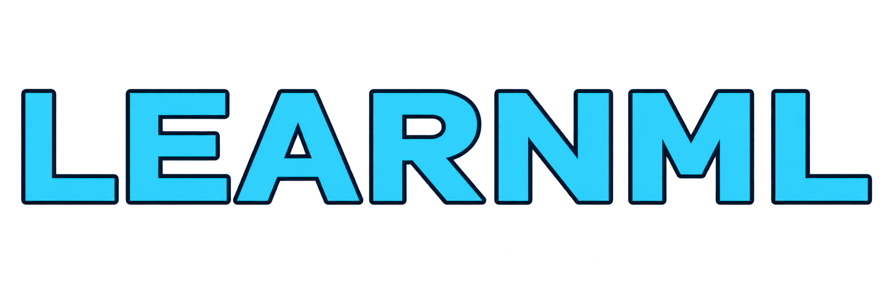

<p align="center">
  
</p>

<h3 align="center">
  Learn Machine Learning from Scratch
</h3>

---

## About LEARNML

**LEARNML** is a personal machine learning library developed to explore, understand, and implement machine learning concepts from the ground up.

The main goal is not simply to use existing machine learning libraries, but to understand what happens behind the scenes.

By implementing machine learning concepts using Python and NumPy, LEARNML explores the mathematical foundations, internal operations, and learning processes behind machine learning models.

The project also includes educational explanations and visualizations to make complex machine learning concepts easier to understand.

> Understand the mathematics. Implement the concepts. Visualize the process.

---

## Features

- **From-Scratch Implementations:** Build machine learning components using Python and NumPy.
- **Mathematical Understanding:** Explore the mathematics behind training, optimization, and prediction.
- **Educational Visualizations:** Visualize how machine learning concepts work internally.
- **Practical Experiments:** Test implementations using real and synthetic datasets.
- **Continuous Development:** New features, improvements, and educational materials are added over time.

---

## Educational Visualizations

One of the main goals of LEARNML is to make machine learning easier to understand visually.

The project includes custom visualizations that explain algorithm workflows, mathematical operations, model architectures, and internal learning processes.

These visualizations aim to provide an intuitive understanding of how machine learning models learn, make predictions, and improve through training.

---

## Technologies

| Technology | Purpose |
|---|---|
| Python | Main programming language |
| NumPy | Mathematical operations and numerical computing |
| Matplotlib | Educational and data visualizations |
| Jupyter Notebook | Interactive experimentation |

---

## Installation

Clone the repository:

```bash
git clone https://github.com/7sn3rif/LearnML_Library.git
```

Navigate to the project directory:

```bash
cd LearnML_Library
```

Create a virtual environment:

```bash
python -m venv .venv
```

Activate it:

**Linux / macOS**

```bash
source .venv/bin/activate
```

**Windows**

```bash
.venv\Scripts\activate
```

Install dependencies:

```bash
pip install -r requirement.txt
```

---

## Project Structure

```text
LearnML_Library/
│
├── LearnML/
│   └── Machine learning implementations
│
├── testing/
│   └── Experiments and testing
│
├── assets/
│   └── learnml-logo.png
│
├── requirement.txt
│
└── README.md
```

---

## Project Goals

The long-term goals of LEARNML include:

- Building a collection of reusable machine learning components.
- Exploring the mathematical foundations of machine learning.
- Improving educational explanations and visual representations.
- Exploring optimization techniques and neural network architectures.
- Understanding the process of training, evaluating, and deploying models.
- Exploring model optimization and TinyML concepts for resource-constrained devices.

---

## Development Status

LEARNML is an ongoing personal learning and development project.

Features, implementations, and visualizations are continuously being developed, tested, and improved.

Some components may be incomplete or experimental.

---

## Contributing

Suggestions, discussions, and contributions are welcome.

If you find an issue or have an idea for improving the project, feel free to open an issue or submit a pull request.

---

## Author

**7sn3rif**

GitHub: [@7sn3rif](https://github.com/7sn3rif)

---

<p align="center">
  <b>LEARNML</b>
  <br>
  Learn it. Build it. Understand it.
</p>